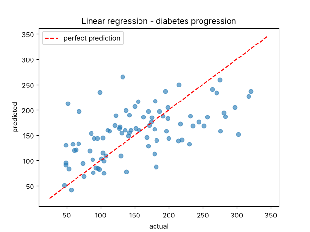
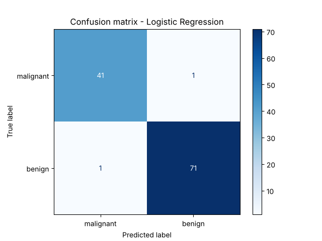

# Data Science & Machine Learning Practice

Three small projects I did after the *Data Science Essentials with Python* course: SQL analysis, regression and classification. All datasets come with scikit-learn so everything runs offline.

## 1. SQL analysis - `sql_analysis.py`
Loads the **wine dataset** (178 wines, 3 cultivars) into a SQLite database and answers questions with SQL:
- count of wines per cultivar (`GROUP BY`)
- average alcohol, color and magnesium per cultivar (`AVG`, `ORDER BY`)
- top 5 wines by alcohol (`LIMIT`)
- wines above the overall average alcohol (subquery)
- cultivars with average proline over 700 (`HAVING`)

```
--- Average alcohol, color and magnesium per cultivar ---
 cultivar  avg_alcohol  avg_color  avg_magnesium
        0        13.74       5.53          106.3
        2        13.15       7.40           99.3
        1        12.28       3.09           94.5
```
It also exports `wine_data.csv` that can be opened in Excel or Power BI.

## 2. Regression - `regression.py`
Predicts diabetes disease progression from 10 medical features.
I implemented **linear regression with gradient descent** myself and compared it with scikit-learn:

| Model | R² | RMSE |
|---|---|---|
| My gradient descent | 0.325 | 58.82 |
| scikit-learn | 0.332 | 58.52 |

Both give almost the same result, which shows the gradient descent converged correctly. The R² is not high because this dataset is hard to predict with a linear model.



## 3. Classification - `classification.py`
Classifies breast tumors as **malignant** or **benign** from 30 features. Compared three models:

| Model | Accuracy |
|---|---|
| **Logistic Regression** | **98.25%** |
| KNN (k=5) | 95.61% |
| Decision Tree | 94.74% |

Features are scaled with `StandardScaler` (fitted on the training data only to avoid data leakage), and the split is stratified so both classes have the same ratio in train and test.



Only 2 mistakes out of 114 test samples. In a medical problem the false negatives (malignant predicted as benign) are the most dangerous, so recall for the malignant class matters more than accuracy.

## Run
```bash
pip install -r requirements.txt
python sql_analysis.py
python regression.py
python classification.py
```
